<a href="https://itsbharatsharma.vercel.app/">
  <picture>
    <source media="(prefers-color-scheme: dark)" srcset="https://raw.githubusercontent.com/bharatsharma19/Bharatsharma19/main/hero-dark.svg" />
    
  </picture>
</a>

  
  
  

  

## About

I am a **Technical Lead and Full-Stack Engineer** working at the intersection of **backend architecture, AI systems, cloud infrastructure, and product engineering**.

I build production AI systems and stay with them once they are live: agents and RAG on top, APIs and queues underneath, and the cloud, security and delivery that keep them running.

## Impact

<table>
  <tr>
    <td align="center" valign="top" width="424">
      <h1>11×</h1>
      faster APIs 
      20-24 s responses brought down to 1-3 s
    </td>
    <td align="center" valign="top" width="424">
      <h1>~8B</h1>
      data points 
      processed behind one recommendation system
    </td>
  </tr>
</table>
<table>
  <tr>
    <td align="center" valign="top" width="424">
      <h1>1,000+</h1>
      automated tests 
      across app, edge functions and database in one product
    </td>
    <td align="center" valign="top" width="424">
      <h1>10</h1>
      apps shipped for clients 
      4 web and 6 mobile, as a freelancer
    </td>
  </tr>
</table>

## How I build

<picture>
  <source media="(prefers-color-scheme: dark)" srcset="https://raw.githubusercontent.com/bharatsharma19/Bharatsharma19/main/system-dark.svg" />
  
</picture>

## Featured projects

<table>
  <tr>
    <td valign="top" width="424">
      <h3>Exevra</h3>
      
Expense and split tracker with an opt-in AI assistant. Money rules live in Postgres behind row-level security, and the assistant fails over between two model providers. 1,000+ automated tests.

      

        
        
        
      

      

    </td>
    <td valign="top" width="424">
      <h3>Vyana</h3>
      
Health and nutrition chatbot built on RAG. A LangGraph workflow retrieves from pgvector, keeps conversation state in Postgres, and remembers user facts across sessions.

      

        
        
        
      

      

    </td>
  </tr>
</table>
<table>
  <tr>
    <td valign="top" width="424">
      <h3>MedXtract</h3>
      
Turns lab report PDFs into structured JSON and CSV. Extraction agents run in parallel, a consensus agent merges their output, and validators check the result.

      

        
        
        
      

      

    </td>
    <td valign="top" width="424">
      <h3>Personal Portfolio</h3>
      
Static Next.js site with a three.js hero and three one-minute systems games. Tested with Playwright on three browser engines, plus accessibility and Lighthouse checks.

      

        
        
        
      

      

    </td>
  </tr>
</table>

## What I work on

<table>
  <tr>
    <td width="220"><b>Backend Engineering</b></td>
    <td width="632">APIs, services, databases, caching, queues, performance, and production reliability</td>
  </tr>
  <tr>
    <td><b>AI Systems</b></td>
    <td>LLM workflows, structured outputs, automation, intelligent product features, and applied AI integrations</td>
  </tr>
  <tr>
    <td><b>Cloud & DevOps</b></td>
    <td>Deployments, CI/CD, Docker, cloud infrastructure, monitoring, and operational workflows</td>
  </tr>
  <tr>
    <td><b>Full-Stack Product</b></td>
    <td>Web applications, internal tools, admin systems, mobile experiences, and user-facing product flows</td>
  </tr>
</table>

## Tech I use

  <picture>
    <source media="(prefers-color-scheme: dark)" srcset="https://skillicons.dev/icons?i=python%2Cts%2Cnodejs%2Cnestjs%2Cfastapi%2Creact%2Cnextjs%2Cvue%2Cnuxt%2Cflutter%2Cpostgres%2Credis%2Cmongodb%2Cdocker%2Cgcp%2Caws%2Cgithubactions%2Cnginx&perline=9&theme=dark" />
    
  </picture>

<table>
  <tr>
    <td width="220"><b>Languages</b></td>
    <td width="632">TypeScript · JavaScript · Python · C++ · Bash</td>
  </tr>
  <tr>
    <td><b>Backend</b></td>
    <td>FastAPI · NestJS · Node.js · Express · Django · Flask</td>
  </tr>
  <tr>
    <td><b>Frontend</b></td>
    <td>React · Next.js · Vue · Nuxt.js · Tailwind CSS</td>
  </tr>
  <tr>
    <td><b>Mobile</b></td>
    <td>Flutter · React Native</td>
  </tr>
  <tr>
    <td><b>AI / LLM</b></td>
    <td>LangGraph · LangChain · RAG · Agents · OpenAI API · Vertex AI</td>
  </tr>
  <tr>
    <td><b>Data</b></td>
    <td>PostgreSQL · Redis · MySQL · MongoDB · Neo4j · Firebase</td>
  </tr>
  <tr>
    <td><b>Cloud / DevOps</b></td>
    <td>GCP · AWS · Docker · GitHub Actions · GitLab CI · Jenkins · Nginx</td>
  </tr>
  <tr>
    <td><b>Testing / Monitoring</b></td>
    <td>Jest · Cypress · Prometheus · Grafana · New Relic</td>
  </tr>
</table>

## GitHub activity

<table>
  <tr>
    <td align="center" width="850">
      <picture>
        <source media="(prefers-color-scheme: dark)" srcset="https://streak-stats.demolab.com?user=bharatsharma19&hide_border=true&background=00000000&card_width=819&ring=3B82F6&fire=2DD4BF&currStreakNum=F8FAFC&sideNums=F8FAFC&currStreakLabel=60A5FA&sideLabels=CBD5E1&dates=94A3B8&stroke=334155" />
        
      </picture>
    </td>
  </tr>
</table>
<table>
  <tr>
    <td align="center" width="850">
      <picture>
        <source media="(prefers-color-scheme: dark)" srcset="https://github-readme-activity-graph.vercel.app/graph?username=bharatsharma19&bg_color=00000000&hide_border=true&area=true&height=300&radius=10&custom_title=Contributions%2C%20last%2031%20days&color=94A3B8&title_color=F8FAFC&line=3B82F6&point=2DD4BF&area_color=3B82F6" />
        
      </picture>
    </td>
  </tr>
</table>

## Engineering profile

~~~ts
const bharat = {
  role: "Technical Lead / Lead Full-Stack Engineer",
  focus: ["AI-enabled products", "backend platforms", "cloud systems"],
  strengths: ["architecture", "execution", "debugging", "production ownership"],
  principles: [
    "Build for clarity",
    "Design for change",
    "Debug with evidence",
    "Automate repeated work",
    "Protect users and systems",
    "Keep production boring",
  ],
} as const;
~~~

  
<strong>Technical leadership</strong>

 

- Lead engineering work across backend, frontend, AI, infrastructure, and product-facing systems.
- Review technical decisions with a focus on maintainability, reliability, and long-term scalability.
- Collaborate across product, design, research, and engineering teams to turn complex requirements into working systems.
- Help improve development workflows, production readiness, and overall engineering quality.

  
<strong>Backend and platform engineering</strong>

 

- Design and build APIs, services, database models, and backend workflows.
- Work with caching, background jobs, queues, scheduled tasks, and production debugging.
- Improve system performance, reliability, and developer experience.
- Build systems with clear separation of concerns and maintainable architecture.

  
<strong>AI and automation</strong>

 

- Build applied AI workflows for real product use cases.
- Work with LLM orchestration, structured responses, validation, automation, and internal tooling.
- Focus on reliability, traceability, and practical usefulness of AI features in production environments.
- Translate complex inputs into cleaner, more actionable software outputs.

  
<strong>Cloud, security and production operations</strong>

 

- Work with cloud deployments, CI/CD pipelines, Dockerized services, server maintenance, and environment configuration.
- Improve operational workflows around logs, monitoring, background jobs, and production releases.
- Apply security-conscious engineering practices around authentication, access control, file handling, and system hardening.
- Debug production issues across services and coordinate safe releases.

  
<strong>Product and user experience</strong>

 

- Build user-facing web experiences, internal backoffice tools, and mobile application flows.
- Improve UI responsiveness, dark/light mode compatibility, navigation, and interaction quality.
- Create internal tools that help teams operate, review, manage, and debug product workflows faster.
- Balance engineering depth with product usability.

 

  <b>Open to</b> 
  Technical Lead · Lead Full-Stack Engineer · AI Systems Engineer 
  Backend Engineer · Platform Engineer · Founding Engineer

  <a href="https://itsbharatsharma.vercel.app/">Portfolio</a> · <a href="https://www.linkedin.com/in/bharatsharma1909/">LinkedIn</a> · <a href="mailto:itsbharatsharma19@gmail.com">itsbharatsharma19@gmail.com</a>

<picture>
  <source media="(prefers-color-scheme: dark)" srcset="https://capsule-render.vercel.app/api?type=waving&height=110&section=footer&color=0:1E3A8A%2C50:2563EB%2C100:14B8A6" />
  
</picture>
